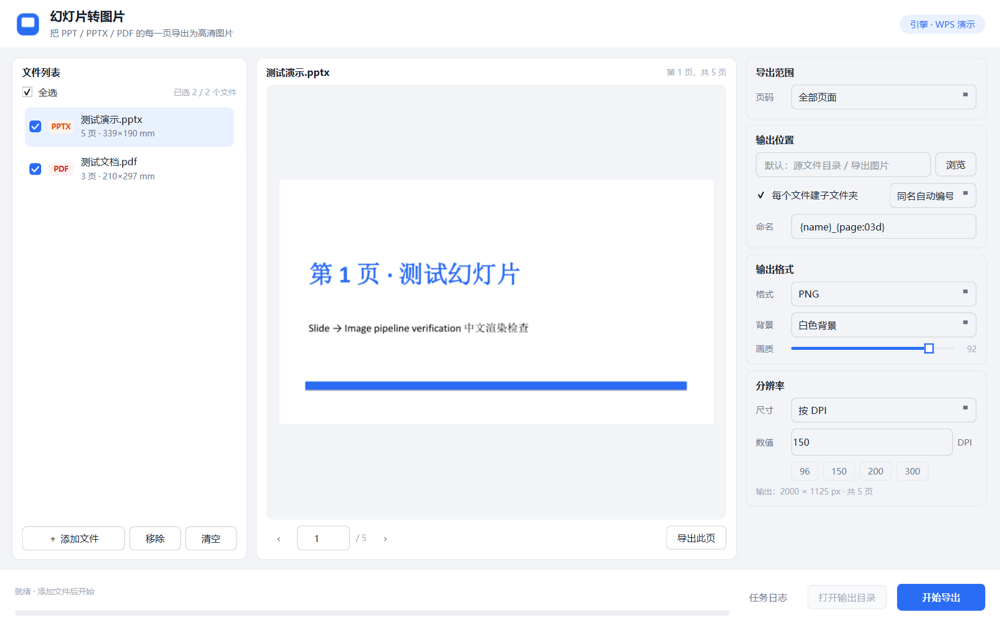
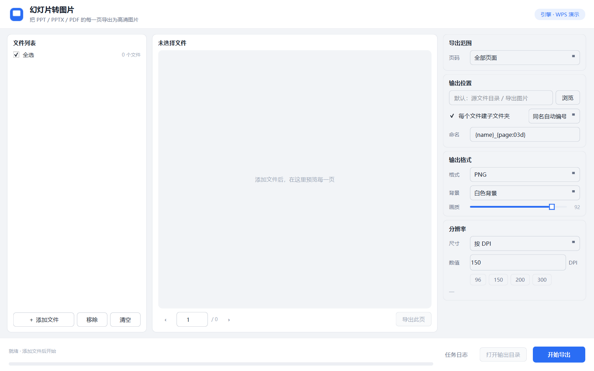
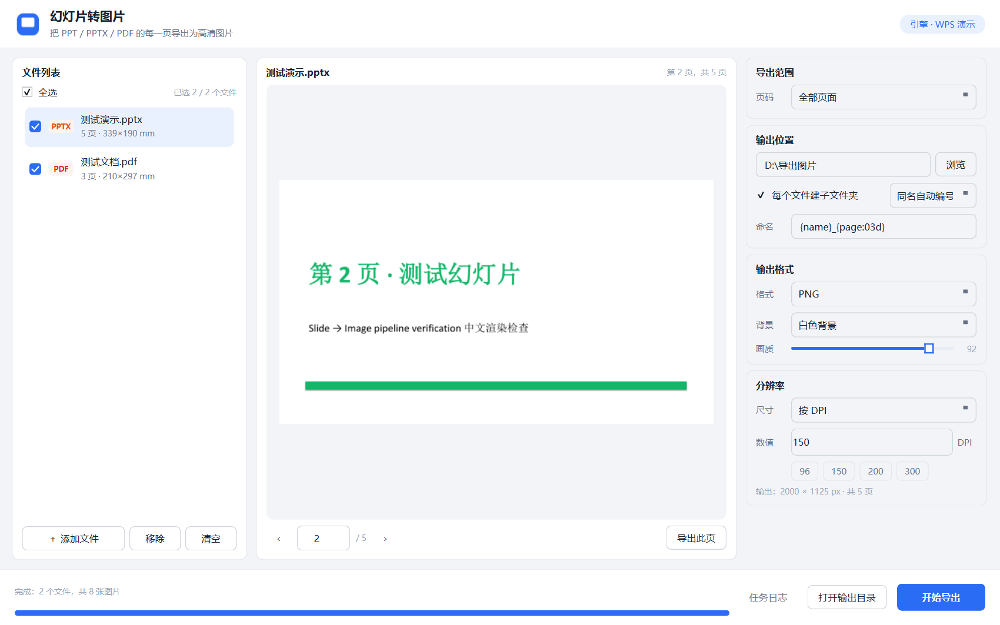

# 幻灯片转图片 · PPT2Image

把 **PPT / PPTX / PPT(97-2003) / PDF** 的每一页导出成高清图片的 Windows 桌面工具。
支持导出单页、指定页码、全部页面，可批量处理多个文件。




---

## 功能

- **多格式支持**：`.pptx` `.pptm` `.ppt` `.pps` `.ppsx` `.ppsm` `.pot` `.potx` `.odp` `.pdf`
- **三种导出范围**
  - 全部页面：每个文件逐页导出
  - 当前预览页：只导出预览区显示的那一页
  - 指定页码：`1,3,5-9` 这种写法，越界自动忽略
- **分辨率可控**：按 DPI（48~600）或按宽度 / 高度像素，带 96 / 150 / 200 / 300 快捷键
- **三种输出格式**：PNG（无损）、JPG（体积小）、WEBP（体积最小）
- **背景可选**：白色 / 黑色 / 透明（透明仅 PNG、WEBP 有效）
- **批量处理**：勾选任意多个文件一次导出，显示总体进度，可随时取消
- **实时预览**：翻页查看每一页，自动换算输出尺寸
- **命名模板**：`{name}_{page:03d}` 可自由组合，支持 `{name}` `{page}` `{index}` `{total}`
- **同名策略**：自动加序号 / 覆盖 / 跳过
- **拖拽添加**：文件直接拖进窗口即可

### 界面

| 空状态 | 预览与选页 | 导出完成 |
|---|---|---|
|  |  |  |

---

## 快速开始

### 方式一：下载可执行文件（推荐给普通用户）

从 [Releases](https://github.com/zxy12138/ppt2image/releases/latest) 下载 `Ppt2Image-v1.0.0-win64.exe`，双击运行，无需安装 Python。

> 首次运行会解压运行时，需要等几秒钟。如果 Windows Defender 提示风险，这是 PyInstaller 打包程序常见的误报，选择"更多信息 → 仍要运行"即可。

### 方式二：源码运行

需要 Python 3.9 及以上（推荐 3.11+）。

```bash
git clone https://github.com/zxy12138/ppt2image.git
cd ppt2image

python -m venv .venv
.venv\Scripts\activate

pip install -r requirements.txt
python main.py
```

Windows 上也可以直接双击 `安装依赖.bat`（自动建虚拟环境并装依赖），之后用 `启动.bat` 或 `调试启动.bat` 启动。

---

## 使用说明

### 1. 添加文件

点击左下角 **＋ 添加文件**，或把文件直接拖进窗口。支持多选。
添加后会显示每页尺寸和总页数。

### 2. 预览与选页

点击左侧任意文件，中间会显示当前页。
用预览区下方的 `‹` `›` 或页码框翻页，右下角 **导出此页** 可以只导出当前这一页。

### 3. 设置参数

右侧面板从上到下依次是：

| 分组 | 选项 | 说明 |
|---|---|---|
| 导出范围 | 页码 | 全部页面 / 当前预览页 / 指定页码 |
| 输出位置 | 保存到 | 留空则导出到「源文件目录 / 导出图片」 |
| | 每个文件建子文件夹 | 开启后每个文件一个同名文件夹 |
| | 命名 | 文件名模板，例如 `{name}_{page:03d}` |
| | 同名自动编号 | 目标已存在同名图片时：自动编号 / 覆盖 / 跳过 |
| 输出格式 | 格式 | PNG / JPG / WEBP |
| | 背景 | 白色 / 黑色 / 透明 |
| | 画质 | JPG、WEBP 的质量（40~100） |
| 分辨率 | 尺寸 | 按 DPI / 按宽度 / 按高度 |
| | 数值 | DPI 值或像素值 |

### 4. 导出

勾选要处理的文件（默认全选），点右下角 **开始导出**。
底部进度条显示总进度，点 **任务日志** 可以看到每个文件的处理结果。
完成后点 **打开输出目录** 直接跳转到结果文件夹。

### 命名模板

| 占位符 | 含义 | 示例 |
|---|---|---|
| `{name}` | 源文件名（不含扩展名） | `季度汇报` |
| `{page}` | 页码，从 1 开始 | `7` |
| `{page:03d}` | 页码补零到 3 位 | `007` |
| `{index}` | 输出序号，从 1 开始 | `7` |
| `{total}` | 总页数 | `20` |

例如模板 `{name}_{page:03d}`、文件 `季度汇报.pptx` 第 7 页 → `季度汇报_007.png`。

---

## 常见问题

**提示"未检测到转换引擎"**

转换 PPT 类文件需要本机装有 **WPS Office** 或 **Microsoft PowerPoint** 之一。程序会自动检测，装任意一个即可。
PDF 文件不依赖任何 Office，随时可用。

**转换时屏幕闪了一下 / 任务栏多出 WPS 图标**

正常现象。调用 WPS 的自动化接口必须让它可见（否则会报错），程序会立即把它最小化。
转换在独立子进程里进行，结束后自动退出。

**第一次转换比较慢**

首次需要启动 WPS/PowerPoint，约 3~6 秒；后续文件会快一些。

**提示"转换超时"**

单个文件超过 5 分钟会强制终止，并提示是哪个文件。常见原因是文件特别大，或 WPS 弹出了对话框卡住了。

**加密文件打不开**

带打开密码的 PPT / PDF 暂不支持，会提示"该文件已加密"。请先用原软件解除密码。

**导出到哪了？**

输入框留空时，默认导出到 **源文件所在目录下的「导出图片」文件夹**。
如果每个文件建了子文件夹，则是「导出图片/文件名/」。

**transparent 背景导出后还是不透明？**

只有当幻灯片本身没有铺满背景色时才有透明区域。如果页面本身有白色底，导出就是白底。

---

## 工作原理

```
┌──────────┐   Office COM 自动化    ┌──────────┐   PyMuPDF 光栅化   ┌──────────┐
│ PPT/PPTX │ ────────────────────▶ │   PDF    │ ─────────────────▶ │  PNG/JPG │
└──────────┘  （独立子进程，可超时）  └──────────┘   任意 DPI / 尺寸    └──────────┘
┌──────────┐
│   PDF    │ ───────────────────────────────────────────────────────▶
└──────────┘
```

统一走「先转 PDF 再光栅化」这条链路，好处是：

- 文字是矢量的，任意分辨率都清晰，不会出现截图式模糊
- PDF 与 PPT 共用同一套页码、命名、导出逻辑
- 转换崩溃或卡死不影响主界面（子进程隔离，超时可 kill）

### 转换引擎优先级

1. **Microsoft PowerPoint**（`PowerPoint.Application`）
2. **WPS 演示**（`KWPP.Application`）
3. **LibreOffice**（`soffice.exe --headless`）

程序在启动时读取注册表检测，不启动任何 Office 进程。可以在顶部引擎标签处手动切换。

---

## 项目结构

```
ppt2image/
├── main.py                  # 入口，同时承担 --office-worker / --selftest 分发
├── app/
│   ├── engines.py           # 引擎检测 + Office→PDF（子进程调用）
│   ├── office_worker.py     # 转换子进程本体
│   ├── converter.py         # PDF 光栅化、RenderOptions
│   ├── pages.py             # 页码解析、命名模板
│   ├── worker.py            # 解析线程、导出线程
│   └── ui/
│       ├── main_window.py   # 主窗口
│       ├── settings_panel.py# 右侧参数面板
│       ├── widgets.py       # 卡片、文件列表绘制、预览控件
│       └── theme.py         # 配色与 QSS
├── tools/                   # 开发用脚本（生成测试样本、截图、打包图标等）
├── docs/screenshots/        # 界面截图
├── assets/                  # 图标
├── build.spec               # 单文件 exe 打包配置
├── build_onedir.spec        # 目录版打包配置（启动更快）
└── requirements.txt
```

---

## 开发

### 环境

```bash
python -m venv .venv
.venv\Scripts\activate
pip install -r requirements.txt
```

依赖：PySide6、PyMuPDF、Pillow、pywin32（仅 Windows）。

### 自检与测试

```bash
# 生成测试样本（PPTX / PDF）
python tools/make_samples.py

# 核心逻辑测试：页码解析、命名模板、导出链路、冲突策略
python tools/test_export.py

# 端到端：真实启动界面 -> 添加文件 -> 点击导出 -> 校验产物
python tools/test_ui_export.py

# 生成界面截图
python tools/shot_ui.py
```

### 打包

```bash
# 目录版（启动快，约 1~2 秒，推荐）
pyinstaller build_onedir.spec --noconfirm --clean

# 单文件版（方便分发，启动需解压，约 5~6 秒）
pyinstaller build.spec --noconfirm --clean
```

打包后可用 `幻灯片转图片.exe --selftest` 检查运行时是否完整，
结果写在 `%TEMP%\ppt2image_selftest.txt`。

---

## 已知限制

- 只测试了 Windows；理论上 Linux/macOS 可用 LibreOffice 方案，但未验证
- 不支持带密码的文档
- 批量处理时每个 PPT 都会单独启动一次转换子进程，文件很多时会慢一些
- 幻灯片里的动画、切换效果不会体现在静态图片里（本来就是静态导出）

---

## 许可

[MIT License](LICENSE)
